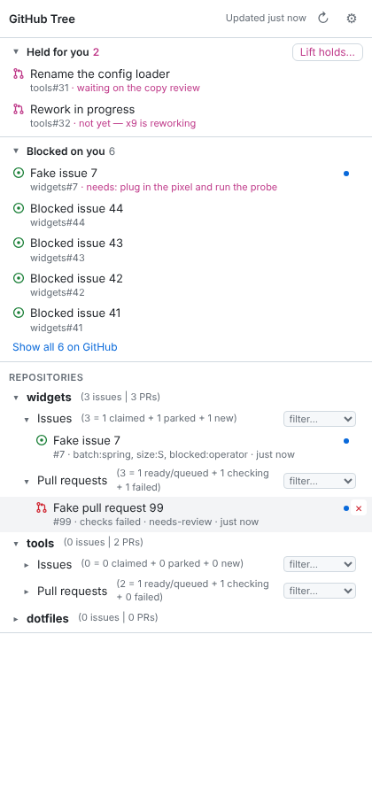

# GitHub Tree

A Chrome side panel that keeps the GitHub work you have in flight in one place:

- **Every repository** the token can read (archived ones aside), in bold, in the
  order you choose. Drag a repository by its name to reorder, or focus it and press
  Alt+↑/↓. Each row shows `(X issues | Y PRs)`. A setting hides the owner
  (`widgets` rather than `acme/widgets`), except where two owners share a name.
- **Issues** `(X = Y claimed + Z parked + N new)`: claimed has a `batch:*` label,
  parked has `parked`, new has neither, so the three always add up. Under it, the
  issues you have visited that are still open. Its **filter…** menu opens GitHub's
  list filtered to **blocked on me** (`blocked:operator`), **parked**,
  **unclaimed** (no `batch:` label, not parked), or **S**, **M**, **L** or **XL**
  (the `size:*` labels), each with its count.
- **Pull requests** `(X = A ready/queued + B checking + C failed)`: ready is green,
  no checks or in the merge queue; checking has something running; failed has
  something red. On a held PR, the `require-label` check is ignored, because the
  hold is what makes it red ([Conventions](#conventions)). Under it, the PRs you have visited; its **filter…** menu offers
  **held**, **failed** and **blocked on me** (`needs-review`, or a review requested
  from you). GitHub has no single filter for that last one, so it opens the PRs
  themselves.
- **Actions**: the workflow runs and workflows you have visited.
- **Held for you:** open PRs labelled `hold:operator`, each with the reason from its
  latest `**Held:**` comment. **Lift holds…** lists them with checkboxes: holds
  whose comment says `Safe to lift: now` start ticked; `not yet` (someone is
  reworking the PR) can't be ticked; anything pushed after its hold comment is
  flagged and left unticked. Lifting removes the `hold:operator` label, and it is
  the extension's only write to GitHub.
- **Blocked on you:** open issues labelled `blocked:operator`, each with what it
  needs from you ([Conventions](#conventions)).
- **One window for GitHub:** a GitHub link that opens in some other window (a link
  from Claude, from Slack, from anywhere) is moved into your main window, put in its
  repo's tab group and brought to the front. If that page is already open, you're
  taken to the existing tab and the duplicate is closed.

Clicking an entry switches to its tab if one is open (a blue dot marks those) and
opens one in the main window if not. Clicking a row's name (a repository, Issues,
Pull requests) opens the matching list on GitHub. **×** closes the item's tab and
takes it off the list.



## Install

1. Clone this repo: `git clone https://github.com/dmgsn1/github-treeview-chrome-extension`.
2. In Chrome, open `chrome://extensions`, turn on **Developer mode**, click
   **Load unpacked**, and pick the clone's folder.
3. Pin the extension and click its icon to open the side panel.
4. The panel opens on its settings (⚙) the first time. **How to create a token**
   there walks through both kinds:
   - **Fine-grained**: resource owner = the organisation you work in, all
     repositories; *Actions*, *Commit statuses*, *Contents* and *Issues* read-only;
     *Pull requests* read and write if you want **Lift holds** (read-only otherwise).
     Fine-grained tokens are not offered a *Checks* permission, so individual check
     runs stay hidden; the panel reads the PR's overall check state instead, and for
     a held PR asks the Actions jobs whether anything besides `require-label` failed.
     Without *Commit statuses* or *Contents*, repositories still load, but PR check
     states show as unknown and the panel names the missing permission. One
     fine-grained token covers one owner, and an organisation may have to approve it.
   - **Classic** (covers every owner at once, but `repo` allows writes everywhere):
     scopes `repo` and `read:org`, then authorize it for SSO if the organisation
     uses SAML.

   Press **Save**: the panel checks the token with GitHub and says who it signed
   in as and which owners it can read, or why it failed. The token is kept in
   this browser's extension storage (`chrome.storage.local`) and is sent only to
   `api.github.com`.
5. Leave **Owners to scan** blank to cover everything the token can read: your
   account, your organisations, the owners of every repository the token sees
   (up to 1,000), and anything already in the tree. Enterprise Cloud organisations
   are ordinary organisations here. GitHub Enterprise Server (a company's own
   GitHub host) is not supported. The panel always shows which owners the lists cover.

The tree starts with the GitHub items already open in your tabs and fills as you
browse. The two lists refresh every 5 minutes and when you press ↻.

## Updating

1. Replace the files **in the folder Chrome loads the extension from**. To see
   which folder that is, open `chrome://extensions` → GitHub Tree → **Details** →
   **Source**. Unzipping a new build somewhere else (macOS, for one, unzips
   `github-tree.zip` into a new `github-tree 2` folder rather than overwriting)
   leaves Chrome running the old build. With `git pull` in the same clone, this
   can't happen.
2. Press ↻ on GitHub Tree's card in `chrome://extensions`. Chrome loads the side
   panel's new files on its own but keeps running the old background worker until
   the extension is reloaded. If you forget, the panel says so and offers
   **Reload the extension**.

The settings form shows which build the panel is running ("Build 0.6.0").
Restarting Chrome does not update an unpacked extension; only the two steps above
do.

If you load a new folder with **Load unpacked** instead, Chrome treats it as a
second extension with its own (empty) settings. Remove the old card, or both will
try to gather your GitHub tabs.

## The main window

New GitHub tabs gather in the **main window**. That's the window you picked with
**Gather here instead** in the panel. After a browser restart (window ids don't
survive one), it's the window with the most GitHub tabs.

Only tabs that were **just opened** (in the last 15 seconds) are moved or
de-duplicated, and tabs restored at browser start are left alone. A tab you dragged
to another window yourself, or one you navigate within, stays where it is. Each
behaviour (gather, de-duplicate, group) can be switched off in settings.

A different view of an item that is already open, such as a PR's *Files* tab while
its conversation is open, is a separate tab. A link to one comment of an open PR
takes the existing tab to that comment.

## Conventions

The panel follows a small set of labels and comment markers. Any repository can
use them; the panel only reads them, apart from removing `hold:operator` when you
lift a hold.

| On | Label or marker | Meaning |
|---|---|---|
| PR | `hold:operator` | Wait for the operator before merging. Removing the label is the operator's go-ahead. |
| PR comment | `**Held:** <why>` and `**Safe to lift:** now \| after #N merges \| not yet — <who> is reworking` | Why the PR is held and when lifting is safe. The latest comment with a `**Held:**` line counts. |
| Issue | `blocked:operator` | The work waits on an act only the operator can do: a probe on a device, a credential, a purchase. |
| Issue comment | `**Needs:** <what to do>` | What the operator is asked to do. The latest one counts. |
| Issue | `batch:<name>` | Claimed: the issue belongs to a batch of work. |
| Issue | `parked` | Deliberately not now. |
| Issue | `size:S`, `size:M`, `size:L`, `size:XL` | Size estimate. |
| PR | `needs-review` | Waiting for the operator's review. |
| PR check | `require-label` | A check that stays red while the PR carries `hold:operator`, so the merge waits. The panel does not count it as a failure on a held PR. |

**Blocked on you** lists the open issues labelled `blocked:operator`, each with its
latest `**Needs:**` line; an issue leaves the list when the label comes off. Both
top lists show their five most recently updated entries. When there are more,
**Show all N on GitHub** opens GitHub's search with the same filter, scoped to the
owners the panel scans.

## Development

```sh
npm install
npm test        # unit tests (node:test), no browser
npm run e2e     # loads the extension into Chromium against a local fake github.com
npm run check   # syntax + both of the above: the definition of done
```

`npm run e2e` needs a Chromium that Playwright can drive. Set `CHROMIUM=/path/to/chrome`
to use one you already have, or run `npx playwright install chromium`.

Layout: `src/github-url.js` parses URLs, `src/store.js` holds the visited-items
model, `src/repo-data.js` counts and sorts each repository's issues and PRs,
`src/tabs.js` decides what to do with tabs, `src/github-api.js` talks to GitHub
and `src/blocked.js` reads the **Held:** and **Needs:** comments. All of those are
pure or take an injected `fetch`. `src/background.js` (the service worker) and
`sidepanel/` connect them to Chrome.

## License

[MIT](LICENSE).
